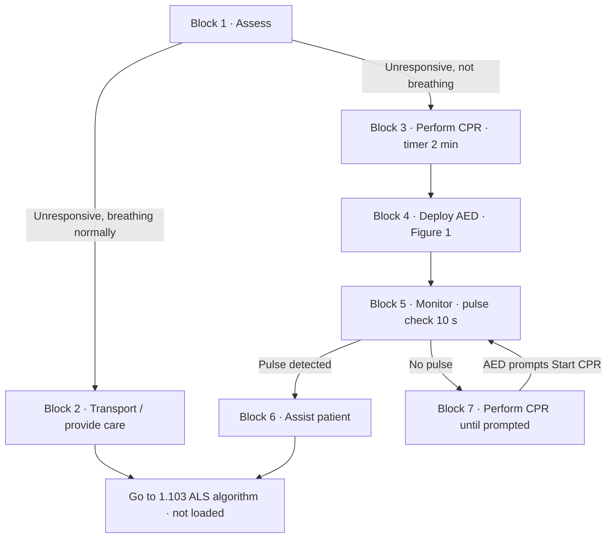

# Emergency guide

How the app guides the crew through a medical emergency when there is no link with Earth. Built on 14 Nov 2026. The tasks are E1 and E2 of the [plan](plan.md), milestone 4.

## Why

On the way to Mars a question to the ground takes minutes to get an answer, or gets none. The ISS manual tells the crew to call mission control at several steps. Without a link, the tablet is what guides them. A mentor confirmed two things we build on: a deep space crew has a doctor on board, and working without the link is what sets a project apart.

## The scene

Transit to Mars, close to arrival. Liam Novak has a cardiac event. The system raises an alert for the commander, Eva Lindqvist, and for the medical officer, Amara Okafor. The medical officer opens it and is guided, by voice and on screen, through NASA's own procedure.

## What each profile sees

| Profile | Screen |
| :-- | :-- |
| Medical officer | The red alert on the whole screen. After a tap, the guide: one block of the procedure at a time |
| Commander | The same alert. After a tap, which block the medical officer is on and for how long, and the task the manual gives the second rescuer |
| Patient | A notice that the medical officer and the commander have been alerted |
| Other crew | The alert, and a way back to their own panel |

Every screen carries a line that says it is a simulation, with a button to end it.

## The guide is a state machine

Each block of the flow chart in the manual is a state. A state has its lines, copied word for word, and the choices that lead to the next state. The medical officer moves on with a tap or by saying the choice aloud.



- **The procedure** is 1.102 AED ASSISTED CPR, from NASA's Emergency Medical Procedures Manual for the ISS (MED CL, 09 APR 15, released under FOIA 16-JSC-F-00174), with its Figure 1.
- **Nobody writes a medical step.** What is ours is kept apart and shown as a note: the question that picks a branch uses the manual's own wording, and where the manual says "Call MCC-H", a note says the call is recorded and sent when the link returns.
- **Which alert opens which procedure** is a table in the code. A heart alert opens 1.102. Low glucose, potassium and a radiation storm are listed on screen as not loaded.

## The voice

There are two voices. The agent is the one the medical officer talks with. The recorded voice is what is left when the agent cannot be reached.

### The voice agent

- An agent of ElevenLabs (ElevenAgents) that talks with the medical officer in real time. She can interrupt it. When her answer matches a choice of the current state, the agent moves the guide to the next state.
- It gives one instruction at a time, in the manual's words, and waits. It adds no step and gives no advice of its own: its instructions are built from `procedures.ts` by `buildAgentPrompt`.
- It moves the guide with one tool, `go_to_step`, which runs in the browser. The app checks that the current state leads to the state asked for, and refuses the move if not.
- A tap on the screen still works. The app tells the agent where the guide is now.
- It starts when the guide opens and needs the microphone. The "Stop talking" button turns it off.
- The agent is private. The browser asks our backend for a signed URL (`POST /api/emergency/voice-session`), and the backend asks ElevenLabs with the key. The key never reaches the browser.
- It needs a network. With no link to Earth a real mission would run the same loop on a model on board; here it is a cloud service, and the screen says when it is not reachable.

To create the agent, or update it after changing a step:

```sh
cd apps/web
node --env-file=../../services/api/.env scripts/create-emergency-agent.mjs
```

The key needs the ElevenAgents permission. The first run prints the agent's id: put it in `services/api/.env` as `ELEVENLABS_AGENT_ID`, and in the environment of the server on Render together with `ELEVENLABS_API_KEY`.

### The recorded voice

It plays when the agent is off or not reachable.

- One audio file per state, written once with ElevenLabs at 1.2 times normal speed and kept in the repo. The app plays the files, so it needs no key and no network during an emergency.
- If a file is missing, the browser's own voice reads the same text at the same pace.
- Voice commands use the browser's speech recognition, where it exists (Chrome). The words are the manual's choices, plus "done" and "next".

To write the audio again after changing a step or the voice:

```sh
cd apps/web
node --env-file=../../services/api/.env scripts/generate-emergency-audio.mjs
```

`ELEVENLABS_API_KEY` is required. `ELEVENLABS_VOICE_ID` is optional; without it the script takes the first voice of the account.

## What is real and what is simulated

| Part | Status |
| :-- | :-- |
| Steps and figure | Real, from the NASA manual |
| Voice | A real voice agent when there is a network. Real audio, recorded ahead, when there is not |
| The heart rate chart of the alert | The last 24 hours are the real readings of that crew member. The abnormal readings after them are invented, drawn dashed and labelled as simulated |
| The event and its detection | Simulated, and the screen says so. A model that detects it from in-flight heart data is not built: there is no open dataset to train it |

## Where it is in the code

| File | What it holds |
| :-- | :-- |
| `apps/web/src/lib/procedures.ts` | The procedure as data: states, lines, choices, timers, figure. Also the table of which alert opens which procedure |
| `apps/web/src/lib/emergency.ts` | The running emergency: who the patient is, when it started, which state the guide is on. Kept in the browser |
| `apps/web/src/features/emergency/EmergencyScreen.tsx` | The screens: alert, guide, status, voice, voice commands and timer |
| `apps/web/src/App.tsx` | Shows the emergency instead of the panel while one is running |
| `apps/web/src/features/profile/ProfilePicker.tsx` | The "Simulate a cardiac event" button |
| `apps/web/src/lib/voiceAgent.ts` | What the agent is told and which moves it may make, built from the procedure |
| `apps/web/src/features/emergency/useVoiceAgent.ts` | The conversation with the agent and its `go_to_step` tool |
| `apps/web/scripts/create-emergency-agent.mjs` | Creates or updates the agent in ElevenLabs |
| `services/api/app/voice.py` | `POST /api/emergency/voice-session`: the signed URL of a conversation |
| `apps/web/scripts/generate-emergency-audio.mjs` | Writes the audio files |
| `apps/web/public/emergency/` | The audio files and Figure 1 |
| `services/api/seed.py`, `database/postgresql/schema/02_dat.sql` | The `medical_officer` role |

To add a procedure: write it in `procedures.ts`, add it to the table of alerts, and run the audio script and the agent script.

## Limits

- The manual we have is partial. It has no chest pain procedure, so the guide starts when the patient is unresponsive.
- 1.102 hands over to 1.103, the ALS algorithm, which is not loaded.
- The emergency lives in one browser. To see it from two profiles, open both on the same device. Sharing it between two tablets means moving it to the backend.
- The backend only hands out the session of the voice agent, so nothing of the emergency is stored or sent to the ground.
- The voice agent sends the conversation to ElevenLabs and to the language model behind it.
