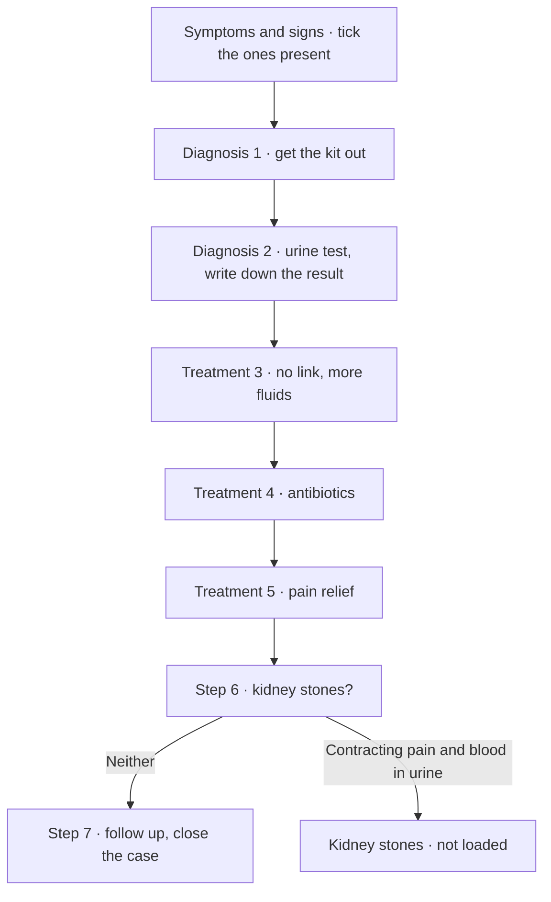

# Guided procedure without Earth

How the app closes the loop when a crew member falls ill and there is no link with Earth: a model flags it, the medical officer is guided through NASA's own procedure by a voice agent, and a report waits for the link. Built on 14 and 15 Nov 2026. The tasks are E1, E2, E4 and E5 of the [plan](plan.md), milestone 4.

## Why

On the way to Mars a question to the ground takes minutes to get an answer, or gets none. NASA's checklists tell the crew to contact the flight surgeon before treating. Without a link, the tablet is what guides them. A mentor confirmed two things we build on: a deep space crew has a doctor on board, and working without the link is what sets a project apart.

The scenario is an infection because it has happened, and Earth mattered each time. Fred Haise flew Apollo 13 with a urinary infection that reached the kidney, and Vladimir Vasyutin was brought back from Salyut 7 in 1985. It is also the case our data covers best: the readings that move come from the watch and from the blood tests at once.

## The loop

1. **Signals.** Seven readings of Liam Novak move away from his own usual values at the same time: skin temperature at night, breathing rate, heart rate variability, blood oxygen, sleep quality, C-reactive protein and lymphocytes. The list was proposed by the team's medical reviewer.
2. **Model.** An infection model flags "possible infection". The model is not built: the detection is simulated, and the screen says so.
3. **Alert.** The medical officer, Amara Okafor, and the commander, Eva Lindqvist, get a red alert with the seven readings under it.
4. **Guided procedure.** The medical officer opens the guide. A voice agent talks her through NASA's checklist, one action at a time, and writes down what she reports.
5. **Report.** She closes the case. The report waits in a queue for the Surgeon and leaves when the link returns. The demo has a button that brings the link back.

## What each profile sees

| Profile | Screen |
| :-- | :-- |
| Medical officer | The alert with the seven readings. After a tap, the guide: one step of the procedure at a time, the voice, and the report filling in |
| Commander | The same alert. After a tap, which step the medical officer is on and for how long, and the report |
| Patient | A notice that his readings point to a possible infection and that the medical officer will examine him |
| Other crew | The alert, and a way back to their own panel |

Every screen carries a line that says it is a simulation, with a button to end it.

## The procedure

BLADDER/KIDNEY INFECTION, from NASA's International Space Station Integrated Medical Group Medical Checklist (JSC-48522-E4, 12 NOV 01). It is the public version; later ones are not public.



- **Nobody writes a medical step.** The instructions, the lists of symptoms and signs, the form and the drug entries are the manual's words.
- **What is ours is said to be ours.** The titles of the steps, the buttons and the drawings of the kit are ours. The card "About this simulation" says so. The steps carry no notes of ours, to keep the screen clean.
- **What is left out is said too**, in the same card: the drugs of the Russian kits (Biseptol, Ampioks, Ciprolet, Tarivid, Nitroxoline, Baralgin), the header of the urinalysis form and the second form, for the URILUX analyzer.
- **The manual has its own rule for no link.** Its note says: "In an emergency or during Loss of Signal, begin appropriate treatment; then call Surgeon as soon as possible." In the manual it opens the procedure; the guide shows it in the treatment step, where it applies. What to do is the medical officer's decision.
- **She can go back** one step at a time, by voice or with a button.

A second procedure stays loaded and is not in the demo: 1.102 AED ASSISTED CPR, from NASA's Emergency Medical Procedures Manual for the ISS (MED CL, 09 APR 15, FOIA 16-JSC-F-00174). It has recorded audio and no voice agent.

## The voice agent

- An agent of ElevenLabs (ElevenAgents) that talks with the medical officer in real time, in English, with a male voice. She can interrupt it.
- It gives one physical action at a time and waits. When she confirms the last action of a step, it moves the guide on by itself. It does not read lists or step numbers.
- It keeps the facts of the manual: items, order, drugs, doses and warnings. It does not choose a drug, give advice or fill a gap the checklist leaves. Its instructions are built from `procedures.ts` by `buildAgentPrompt`.
- It acts on the page through two tools that run in the browser:
  - `go_to_step` moves the guide. The app allows only a step the current one leads to, or the step she came from.
  - `record_findings` writes into the report a symptom that is present, a value of the form or a drug that was given. The app allows only names the current step lists.
- A tap on the screen still works. The app tells the agent where the guide is.
- The agent is private. The browser asks our backend for a signed URL (`POST /api/emergency/voice-session`), and the backend asks ElevenLabs with the key. The key never reaches the browser.
- It needs a network. On a real mission the same loop would run on a model on board; here it is a cloud service. When it cannot be reached the guide works in silence, with its buttons.

To create the agent, or update it after changing a step or its instructions:

```sh
cd apps/web
node --env-file=../../services/api/.env scripts/create-emergency-agent.mjs
```

The key needs the ElevenAgents permission. The first run prints the agent's id: put it in `services/api/.env` as `ELEVENLABS_AGENT_ID`, and in the environment of the server on Render together with `ELEVENLABS_API_KEY`. With the id set, the script updates that agent.

## What is real and what is simulated

| Part | Status |
| :-- | :-- |
| Steps, lists, form and drug entries | Real, from the NASA checklist of 2001 |
| Voice | A real voice agent |
| The usual value of each of the seven readings | Real: the median of that crew member's readings of the last year |
| The reading of the alert | Invented: the usual value plus a fixed change, labelled as simulated |
| The detection | Simulated. The model is not built: there is no open in-flight dataset to train it |
| The link with Earth | Simulated: always down, until the button that brings it back |
| The drawings of the kit | Ours |

## Where it is in the code

| File | What it holds |
| :-- | :-- |
| `apps/web/src/lib/procedures.ts` | The procedures as data: steps, lines, lists, form, drug entries, choices. Also which alert opens which procedure |
| `apps/web/src/lib/voiceAgent.ts` | What the agent is told and what it may move or record |
| `apps/web/src/lib/emergency.ts` | The running case: patient, step, path, report, closed, sent. Kept in the browser |
| `apps/web/src/lib/infectionSignals.ts` | The seven readings and the simulated change of each |
| `apps/web/src/features/emergency/EmergencyScreen.tsx` | The screens: alert, guide, report, status, end |
| `apps/web/src/features/emergency/InfectionSignals.tsx` | The card of the seven readings |
| `apps/web/src/features/emergency/useVoiceAgent.ts` | The conversation with the agent and its two tools |
| `apps/web/src/features/profile/ProfilePicker.tsx` | The "Simulate a possible infection" button |
| `apps/web/scripts/create-emergency-agent.mjs` | Creates or updates the agent in ElevenLabs |
| `apps/web/scripts/generate-emergency-audio.mjs` | Writes the recorded audio of the cardiac procedure |
| `apps/web/public/emergency/` | The drawings of the kit, and the audio and figure of the cardiac procedure |
| `apps/web/tests/voiceAgent.test.mjs` | Tests of the agent's instructions and limits. Run with `npm test` |
| `services/api/app/voice.py` | `POST /api/emergency/voice-session`: the signed URL of a conversation |

To add a procedure: write it in `procedures.ts`, add it to the table of alerts, and run the agent script.

## Limits

- The model flags an infection, not where it is. The guide opens the bladder and kidney checklist; the checklists of other infections are not loaded.
- The Kidney Stones procedure, where step 6 can lead, is not loaded.
- The case lives in one browser. To see it from two profiles, open both on the same device. Nothing is stored in the database and the report is not sent anywhere.
- The voice agent sends the conversation to ElevenLabs and to the language model behind it.
- The endpoint that hands out voice sessions asks for no user, like the rest of the demo. It gives each caller 30 sessions an hour, counted in memory.
- The simulated changes were chosen by us to look like an infection. A clinician has not signed off each one.
