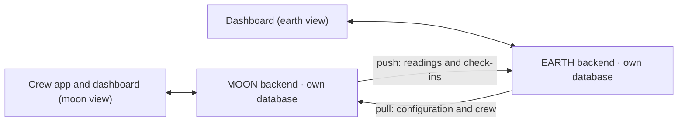

# Real Telemetry · Moon and Earth servers

How the same backend runs as two servers, one on the moon and one on Earth, and how they synchronise. Built on the branch `feat/backend-ivan`.

**Status: built and tested on `feat/backend-ivan`.** It replaces what [plan.md](plan.md) decided on 14 Nov for "Link to the ground" (one backend and one database, data one way only, a link switch). Where the two disagree, this document is the current one. The differences are listed at the end.

## 1. What it is

- One backend, two deployments. `NODE_ROLE=moon` or `NODE_ROLE=earth` in the `.env` decides which one a server is. Same code, same database structure, a separate database each.
- The **moon** is the server on board. It works on its own: the crew app and the dashboard read and write there, with or without a link.
- The **earth** server is the one on the ground. It holds a copy of the crew data for the flight surgeon and mission control, and it is where the configuration and the crew are managed.
- The moon chooses when to connect. Each time, it **sends** its data to earth (push) and **downloads** what is new on earth (pull). Nothing is sent automatically.
- Every synchronisation is recorded on both servers, whether it worked or not.
- The dashboard can show either server: connected to the moon it is the crew's view, connected to earth it is the ground's view, as fresh as the last sync.



## 2. Who writes what

Each table is written on one server only. A row never changes on both sides, so there is never anything to merge.

| Data | Tables | Written on | Synchronised |
| :-- | :-- | :-- | :-- |
| Readings and check-ins | `dat.reading` | Moon | Moon → earth (push) |
| Configuration | `cfg.source`, `cfg.indicator`, `cfg.rule` | Earth | Earth → moon (pull) |
| Crew | `dat.crew_member` | Earth | Earth → moon (pull) |
| Sync history | `his.sync_operation` | Each server its own | Not synchronised |

Earth refuses any table the moon is not allowed to send: the moon can never overwrite a rule or an indicator. When users and authentication arrive, the users will be one more table written on earth and pulled by the moon, so the moon can sign people in without a link.

## 3. How a sync works

1. **Finding what changed.** Every synchronised row has a `sync_seq` column. It takes a number from one sequence, `his.sync_seq`, on every insert, and a trigger gives it a new one on every update. A higher `sync_seq` means a newer change. Changes from the API, the seed files or a manual SQL statement are all caught the same way.
2. **Push.** The moon looks up the `to_seq` of its last successful push and sends earth every moon row with a higher `sync_seq`, oldest change first, in batches of up to 5,000 rows. Earth applies each batch.
3. **Pull.** The moon sends the `to_seq` of its last successful pull. Earth answers with every configuration and crew row changed since, and the highest `sync_seq` it included. The moon applies them all in one transaction, so a failed pull changes nothing.
4. **Applying a row** is an upsert on its primary key: a new row is inserted, an existing one is replaced. Sending the same rows twice, for example after a dropped link, does no harm.
5. **Recording it.** The moon records the push and the pull in `his.sync_operation`, with the new `to_seq` the next sync starts from. Earth records what it received and what it served.

`POST /api/sync` on the moon does the push first and then the pull. Either can be asked for alone.

A push always reaches out to earth, even with nothing to send. Why: a push is also how the moon learns the link works, so an `ok` in the history always means earth was reached.

### Without a link

- The moon goes on working: reading, saving check-ins, showing alerts.
- A sync that cannot reach earth is recorded as `failed`, with the reason (for example `Earth server unreachable: ConnectError`). Its `to_seq` stays empty, so the next push starts from the same point.
- Nothing is lost. The next sync with a link sends everything pending, however long the link was down.
- `GET /api/node` on the moon shows how many rows earth does not have yet.

### Not covered

- **Deleted rows are not synchronised.** The API never deletes; a check-in replaces its readings with an upsert.
- **Two changes committed out of order.** `sync_seq` is taken when a row is written, not when its transaction commits. A long transaction that commits after a later one could be skipped by a push that runs in between. With one API writing small transactions this is unlikely; the fix, if needed, is to push only up to the oldest open transaction.
- **No authentication yet** on the moon endpoints or the history. The two earth endpoints need the shared `SYNC_TOKEN`.

## 4. History: `his.sync_operation`

One row per sync, on both servers. Append only.

| Column | Meaning |
| :-- | :-- |
| `id` | Order of the operations |
| `direction` | Moon: `push` or `pull`. Earth: `received_push` or `served_pull` |
| `peer` | The other server: earth's URL on the moon, `moon` on earth |
| `started_at`, `finished_at` | When it ran, with time zone |
| `status` | `ok` or `failed` |
| `row_count` | Rows sent, received or applied |
| `from_seq`, `to_seq` | The `sync_seq` range included. The next sync in that direction starts at `to_seq` |
| `error` | Why it failed. Never the rows themselves, which may hold medical data |

## 5. Endpoints

| Endpoint | Server | Who calls it | Returns |
| :-- | :-- | :-- | :-- |
| `GET /api/node` | Both | Dashboard | Which server this is and the state of the sync |
| `GET /api/sync/history?limit=20` | Both | Dashboard | The latest syncs, newest first |
| `POST /api/sync` | Moon | Crew or dashboard | Runs a push and a pull now. Body optional: `{"push": true, "pull": true}` |
| `POST /api/sync/push` | Earth | The moon only, with `SYNC_TOKEN` | Applies the moon's rows |
| `GET /api/sync/pull?since=` | Earth | The moon only, with `SYNC_TOKEN` | Earth's rows changed after `since` |

The earth endpoints answer 404 on the moon and the moon endpoint answers 404 on earth. Without the token, the earth endpoints answer 401.

**`GET /api/node`** on the moon:

```json
{
  "role": "moon",
  "sync_configured": true,
  "earth_url": "http://localhost:8001",
  "pending_push_rows": 8,
  "last_push": { "id": 3, "direction": "push", "peer": "http://localhost:8001", "started_at": "2026-11-14T16:19:47Z", "finished_at": "2026-11-14T16:19:47Z", "status": "ok", "row_count": 8, "from_seq": 10865, "to_seq": 10935, "error": null },
  "last_pull": { "...": "same shape" }
}
```

On earth, `earth_url` and `pending_push_rows` are `null`, and `last_push` and `last_pull` are the last push it received and the last pull it served. A server that has never synced has `null` in both.

**`POST /api/sync`** returns the two operations, each with the shape above, or `null` for one that was not asked for:

```json
{ "push": { "status": "ok", "row_count": 8, "...": "..." }, "pull": { "status": "failed", "error": "Earth server unreachable: ConnectError", "...": "..." } }
```

A sync that fails still answers 200: the failure is in the result and in the history. It answers 409 if another sync is running and 503 if `EARTH_URL` or `SYNC_TOKEN` is missing.

## 6. Configuration

In `services/api/.env`, never in git. The template is `services/api/.env.example`.

| Variable | Moon | Earth |
| :-- | :-- | :-- |
| `NODE_ROLE` | `moon` | `earth` |
| `DATABASE_PROVIDER` and its URL | The moon's database | The earth database |
| `EARTH_URL` | Earth's base URL | Not used |
| `SYNC_TOKEN` | Same long random secret on both | Same |

`ENV_FILE` picks another file in `services/api`, so both servers can run on one laptop.

### Both servers on one laptop

Each needs its own database on the local PostgreSQL. `.env` is the moon and `.env.earth` the earth server, both ignored by git.

```sh
cd services/api
uv run python load_database.py                          # moon database
ENV_FILE=.env.earth uv run python load_database.py      # earth database

uv run uvicorn app.main:app --port 8000                       # moon
ENV_FILE=.env.earth uv run uvicorn app.main:app --port 8001   # earth

curl -X POST http://localhost:8000/api/sync                   # sync now
```

Both load the same seed files. After regenerating the seeds, rebuild both databases (`load_database.py --rebuild`): a moon and an earth built from different seeds cannot sync. The first push sends earth every reading the moon has; earth already has the seeded ones and simply replaces them.

### Deployed (proposal)

Two services from this repository, each with its own environment variables and its own Supabase project:

- **Moon:** `NODE_ROLE=moon`, its Supabase, `EARTH_URL` set to the earth service's URL.
- **Earth:** `NODE_ROLE=earth`, its Supabase.
- One worker per service, so two syncs never run at once.
- Supabase through the Session pooler, which works over IPv4.
- On free plans, a service that sleeps takes a while to wake, and the moon records the syncs in between as failed. Wake both before a demo.
- The dashboard will be on another domain, so the API will need CORS for it. Not built yet.

## 7. Code

| File | What it holds |
| :-- | :-- |
| `database/postgresql/schema/03_sync.sql` | `sync_seq`, its trigger and `his.sync_operation` |
| `services/api/app/sync.py` | The sync itself: which tables go which way, push, pull, history. No HTTP |
| `services/api/app/sync_client.py` | The moon's HTTP client for earth. Turns every failure into a short reason |
| `services/api/app/sync_routes.py` | The endpoints of section 5 |
| `services/api/tests/test_sync.py` | Push, pull, batches, a lost link, the history and the endpoints, against two real databases |

## 8. What changed from plan.md

| | plan.md, 14 Nov | Built here |
| :-- | :-- | :-- |
| Servers and databases | One backend and one database | Two backends, each with its own database, from the same code |
| Direction | Ship to ground only. The ground does not answer | Readings go moon → earth. Configuration and crew go earth → moon |
| Lost link | A switch, "Link with Earth: on or off" | The moon syncs when asked. A sync without a link fails and is recorded. A switch for the demo could be added on top |
| Ground panel (G2) | Built from what has reached the ground | The earth server is that: its panel only has what the moon has sent |
| Deployment | Railway (D3) | Proposed: two services and two Supabase projects |
| Sync history | In the `his` schema (G1) | Same: `his.sync_operation` |
