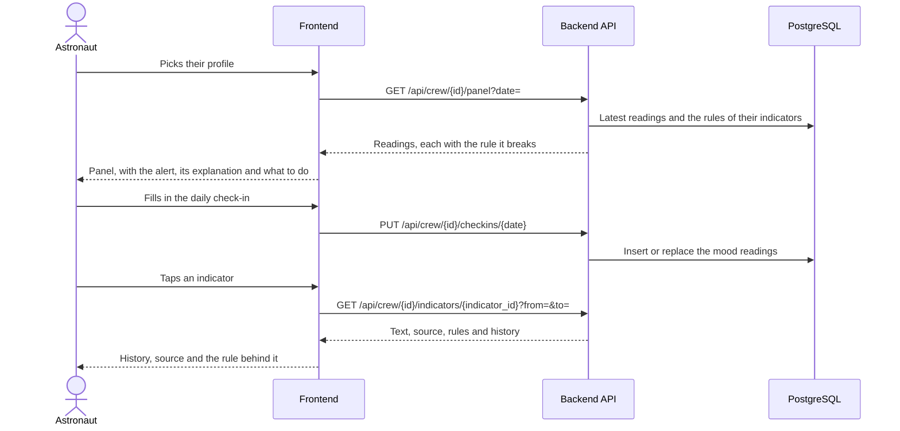

# Real Telemetry · MVP architecture

Scope: the MVP only (R1 to R11 in the System_design, system_design.md). Why each indicator and dataset was chosen is in the data document (parameters_and_datasets.md). The last section lists the starting decisions and how to change each one.

## 1. What we represent

Six concepts. Five are stored. One is computed.

| Concept | What it is | Example | Stored as |
| :-- | :-- | :-- | :-- |
| Crew member | A fictional astronaut. Their data comes from one LifeSnaps volunteer and one Inspiration4 astronaut | "Crew 1" | `crew_member` |
| Source | The dataset an indicator's data comes from (R11) | Inspiration4 metabolic panel | `source` |
| Indicator | One thing we measure, with its unit, how to take it and why it matters (R4 and the brief) | Blood glucose, mg/dL | `indicator` |
| Reading | One value of one indicator for one crew member at one moment | Crew 2, glucose, 36 mg/dL | `reading` |
| Rule | A limit on an indicator, with its explanation, what to do and where the limit comes from (R10, R11) | Glucose below 65 or above 99 | `rule` |
| Alert | A reading that is outside a rule's limits | Crew 2, glucose rule, that reading | Not stored. Computed when read |

What is not a concept:

- The daily check-in (R2, R3). It is the act that creates that day's mood readings.
- The CPR flow (R9). It is fixed content in the frontend. It has no table and no endpoint.
- Accounts and permissions. Not decided. The MVP has a profile picker with no password. If accounts are added later they travel in a header, so the contracts do not change.
- Alert levels. Not decided. A reading either breaks a rule or it does not.

## 2. Data model

One PostgreSQL database with five tables for the panel, in two schemas: `cfg` for what the system knows before any reading arrives, and `dat` for the crew and their readings. A third schema, `his`, holds the history of the synchronisations between the moon and earth servers ([moon_earth_sync.md](moon_earth_sync.md)). The same files build the local database (Docker) and the deployed one. They live in `database/postgresql/schema`, and that folder's README describes every column.

```sql
CREATE TABLE cfg.source (
  id       TEXT PRIMARY KEY,   -- readable key, e.g. 'lifesnaps'
  name     TEXT NOT NULL,
  url      TEXT NOT NULL,
  citation TEXT NOT NULL
);

CREATE TABLE cfg.indicator (
  id             TEXT PRIMARY KEY,   -- readable key, e.g. 'glucose'
  name           TEXT NOT NULL,
  unit           TEXT,               -- NULL for the mood indicators
  how_to_measure TEXT NOT NULL,      -- the brief asks for it per measurement
  why_it_matters TEXT NOT NULL,      -- the short explanation for R4
  source_id      TEXT NOT NULL REFERENCES cfg.source (id),
  measured_by    TEXT NOT NULL,      -- sensor, astronaut or computed
  cadence_days   INTEGER,            -- a new reading is expected every this many days. NULL when computed
  display_order  INTEGER NOT NULL UNIQUE   -- order of the panel
);

CREATE TABLE cfg.rule (
  id               INTEGER GENERATED BY DEFAULT AS IDENTITY PRIMARY KEY,
  indicator_id     TEXT NOT NULL REFERENCES cfg.indicator (id),
  low              DOUBLE PRECISION,
  high             DOUBLE PRECISION,
  baseline_direction  TEXT CHECK (baseline_direction IN ('above', 'below')),   -- personal baseline rule
  baseline_deviations DOUBLE PRECISION CHECK (baseline_deviations > 0),
  title            TEXT NOT NULL,
  explanation      TEXT NOT NULL,
  action           TEXT NOT NULL,
  threshold_source TEXT NOT NULL,
  CHECK ((low IS NOT NULL OR high IS NOT NULL) <> (baseline_direction IS NOT NULL)),   -- fixed or baseline, never both
  CHECK ((baseline_direction IS NULL) = (baseline_deviations IS NULL)),
  CHECK (low IS NULL OR high IS NULL OR low <= high)
);

CREATE TABLE dat.crew_member (
  id   INTEGER GENERATED BY DEFAULT AS IDENTITY PRIMARY KEY,
  name TEXT NOT NULL UNIQUE,
  role TEXT NOT NULL CHECK (role IN ('commander', 'medical_officer', 'crew_member'))
);

CREATE TABLE dat.reading (
  crew_member_id INTEGER          NOT NULL REFERENCES dat.crew_member (id),
  indicator_id   TEXT             NOT NULL REFERENCES cfg.indicator (id),
  taken_at       TIMESTAMP        NOT NULL,   -- no time zone
  value          DOUBLE PRECISION NOT NULL,
  PRIMARY KEY (crew_member_id, indicator_id, taken_at)
);
```

What changed from the SQLite model of the base: the two schemas, `display_order` on `indicator` (SQLite ordered the panel by `rowid`, which PostgreSQL does not have), and `taken_at` stored as a timestamp instead of text. The API still returns `taken_at` as YYYY-MM-DDTHH:MM, so the contracts did not change.

Choices and why:

- One narrow `reading` table, not one column per indicator. A new indicator is new rows in `indicator`, `reading` and, if it has a limit, `rule`. No schema change (R8).
- One numeric value per reading. Mood is seven yes or no indicators, stored as 1 or 0, because a LifeSnaps day can hold several moods. In the daily file 981 days have one mood, 973 have two, 335 have three and 1 has four.
- No `alert` table. A reading is an alert when `value < rule.low OR value > rule.high` for a rule of its indicator, or when it is beyond the personal limit of a baseline rule (section 5). Storing that again would duplicate what `reading` and `rule` already say.
- A rule may set only one side. Use two rules when the low side and the high side need different text.
- Limits live only in `rule`. The frontend never hardcodes one.
- Dataset subject ids (the LifeSnaps id, the Inspiration4 crew code) stay in the seed script. The app does not need them.

`taken_at`:

- One format for all readings. No time zone. LifeSnaps values keep the date and hour the file gives.
- Daily values and blood draws use `T00:00`. Hourly values use the hour.
- The Inspiration4 file has labels (L-92, R+45), not dates. NASA's study metadata gives them as "Launch minus" and "Return plus" in days. With launch on 16 September 2021 and landing on 18 September 2021 (UTC), the draws fall on 2021-06-16, 2021-08-03, 2021-09-13, 2021-09-19, 2021-11-02, 2021-12-09 and 2022-03-31. They can be off by one day, because the launch was on 15 September in local time.

How each dataset becomes readings:

| File | Indicator ids | Note |
| :-- | :-- | :-- |
| LifeSnaps daily | `resting_heart_rate`, `sleep_duration`, `sleep_efficiency`, `skin_temperature`, `very_active_minutes`, `steps`, `mood_happy`, `mood_sad`, `mood_tense`, `mood_alert`, `mood_rested`, `mood_neutral`, `mood_tired`, `spo2`, `breathing_rate`, `heart_rate_variability`, `stress_score`, `sleep_awake_minutes`, `vo2_max` | One reading per person, day and indicator. Each mood column holds 0 or 1 and becomes its own indicator. The frontend shows the seven moods as one card |
| RadLab | `radiation_dose_rate` | One reading per day: the mean absorbed dose rate of the Lidal detector, which reports every 5 minutes. The other detectors sample unevenly and stop for weeks. The same for the four crew members, because it is a reading of the ship |
| LifeSnaps questionnaires (STAI, PANAS) | `anxiety_score`, `positive_affect`, `negative_affect` | One reading per person and answered questionnaire, 2 to 7 each |
| LifeSnaps daily, computed | `mood_sad_days_14`, `mood_tense_days_14` | For each day with a mood entry, on how many of the 14 days ending on it the mood was chosen (section 5) |
| LifeSnaps hourly | `heart_rate` | One reading per person and hour |
| Inspiration4 metabolic panel | `glucose`, `sodium`, `potassium`, `chloride`, `creatinine`, `urea_nitrogen`, `egfr`, `albumin`, `calcium` | 7 readings of each per crew member |
| Inspiration4 blood count | `white_blood_cells`, `lymphocytes`, `hemoglobin` | 7 readings of each per crew member |
| Inspiration4 cardiovascular and immune panels | `crp`, `fibrinogen`, `il_6`, `tnf_alpha`, `il_1_beta`, `ifn_gamma` | 7 readings of each per crew member (one draw is missing in the Alamar file) |

An empty cell produces no reading.

## 3. Components

| Component | What it does | Reads | Writes |
| :-- | :-- | :-- | :-- |
| Seed script | Turns the raw CSV files and `seed_content.py` into INSERT files, which are kept in git. Run it again after changing the crew, a text, a rule or how a dataset becomes readings | Raw CSV files | `database/postgresql/seeds` |
| PostgreSQL database | The only place data is stored. Built from the schema files and the INSERT files, in Docker on a laptop and on Render for the jury |  |  |
| Backend API | Serves the crew, the panel and the history, with alerts computed. Saves the check-in | PostgreSQL | PostgreSQL |
| Frontend | Tablet web app. Profile picker, panel, indicator detail, check-in, CPR flow | Backend API |  |

Everything runs on board with no network calls at runtime. The frontend loads nothing from the internet.

Stack: Python with FastAPI and SQLAlchemy for the backend and seed script, PostgreSQL 17 for the database, React with Vite and TypeScript for the frontend. Confirmed on 14 Nov, the base is built with it. Where each part lives is in the README.

The seed script is two files in `services/api`. `seed.py` holds the crew and the code that turns each CSV file into readings. `seed_content.py` holds the sources, the indicators and the rules, with their text.

Endpoints:

| Endpoint | Returns |
| :-- | :-- |
| `GET /api/crew` | The crew members with their role, `commander` or `crew_member`, for the profile picker |
| `GET /api/crew/{id}/panel?date=` | For each indicator, its latest reading up to the end of `date`, with its `taken_at`, and the rule it breaks, if any, with that rule's text (R1, R10) |
| `GET /api/crew/{id}/indicators/{indicator_id}?from=&to=` | The indicator's text, source and rules, plus its readings between the two dates, each with the rule it breaks, if any (R4, R7, R10, R11) |
| `PUT /api/crew/{id}/checkins/{date}` | Body: moods, the list of mood indicator ids chosen. Saves the seven mood readings for the date in the path, 1 for the chosen ones and 0 for the rest. Replaces them if they exist and returns what was saved (R2, R3) |

The dataset days are in 2021 and 2022, so "today" is the `date` the frontend sends, not the clock. The frontend prompts for the check-in when the panel's mood readings are not from `date` (R3).

### Contracts for the base

The exact JSON of the three endpoints the base needs. Frontend and backend build against it. A change here is agreed by both sides first.

- Dates are YYYY-MM-DD. taken_at is YYYY-MM-DDTHH:MM.
- The panel returns one entry per indicator. A missing reading or rule is null, never an absent key.
- `measured_by`, `cadence_days` and `due` were added on 14 Nov for the measurement routines. `due` is true when a new reading is expected by the day of the panel and has not arrived: for what the astronaut measures, when the last reading is `cadence_days` old or more; for a sensor, when it is older than that; never for a computed value. An indicator with no reading at all is due.
- Readings come ordered by taken_at, oldest first.
- An unknown crew member or indicator returns 404 with {"detail": "..."}.
- `date`, `from` and `to` are required. A missing or malformed one returns 422.
- `from` and `to` are both inclusive. The history runs from the start of `from` to the end of `to`.
- The panel lists the indicators in the order `seed_content.py` defines them, stored as `display_order`.
- A reading exactly on a limit does not break the rule.

**`GET /api/crew`**

```json
{
  "crew": [
    { "id": 1, "name": "Eva Lindqvist", "role": "commander" }
  ]
}
```

**`GET /api/crew/1/panel?date=2021-11-02`**

```json
{
  "date": "2021-11-02",
  "indicators": [
    {
      "id": "glucose",
      "name": "Blood glucose",
      "unit": "mg/dL",
      "reading": { "taken_at": "2021-11-02T00:00", "value": 36.0 },
      "measured_by": "astronaut",
      "cadence_days": 30,
      "due": false,
      "broken_rule": { "id": 1, "title": "...", "explanation": "...", "action": "..." }
    },
    {
      "id": "heart_rate",
      "name": "Heart rate",
      "unit": "bpm",
      "reading": null,
      "broken_rule": null
    }
  ]
}
```

**`GET /api/crew/1/indicators/glucose?from=2021-06-01&to=2021-12-31`**

```json
{
  "indicator": {
    "id": "glucose",
    "name": "Blood glucose",
    "unit": "mg/dL",
    "how_to_measure": "...",
    "why_it_matters": "...",
    "source": { "id": "...", "name": "...", "url": "...", "citation": "..." }
  },
  "rules": [
    { "id": 1, "low": 65.0, "high": 99.0, "baseline_direction": null, "baseline_deviations": null, "title": "...", "explanation": "...", "action": "...", "threshold_source": "..." }
  ],
  "readings": [
    { "taken_at": "2021-09-13T00:00", "value": 90.0, "broken_rule_id": null },
    { "taken_at": "2021-11-02T00:00", "value": 36.0, "broken_rule_id": 1 }
  ]
}
```

The numbers are examples. Text shown as "..." comes from the seed script. PUT /api/crew/{id}/checkins/{date} is not part of the base. Its body is { "moods": ["mood_happy", "mood_rested"] } and it returns what was saved:

```json
{ "date": "2021-11-02", "moods": ["mood_happy", "mood_rested"] }
```

- The returned moods come in the order of the check-in: happy, sad, tense, alert, rested, neutral, tired.
- An empty list is valid and saves the seven as 0. A mood id that is not one of the seven returns 422 and saves nothing.
- The seven readings are stored at T00:00 of the date in the path.

## 4. Flow

One day on the tablet.



## 5. Alert rules

Three ways to decide an alert. We build them in this order.

1. Fixed range. The reading is outside a fixed low and high limit. It is in the base.
2. Personal baseline. The reading is compared with that person's own usual values. Built for five indicators (below). It adds two columns to the rule table.
3. Anomaly models. A model learns each indicator and flags what is unusual. It is the stretch goal Indicator models in the System_design, built only if step 2 is not enough.

| Indicator | Alert in the data document | Limits | Where they come from |
| :-- | :-- | :-- | :-- |
| `glucose` | Abnormal glucose regulation. Glucose outside the personal target | 65 to 99 mg/dL | The range columns in the Inspiration4 file |
| `resting_heart_rate` | Tachycardia. Resting HR stays above the personal baseline | Above 100 bpm | American Heart Association definition of tachycardia. General adult reference, not a spaceflight limit |
| `sleep_duration` | Sleep deprivation. Duration below the personal target | Below 420 minutes (7 hours) | AASM and SRS consensus for adults, 2015 (doi 10.5664/jcsm.4758). General adult reference, not a spaceflight limit |
| `sodium`, `potassium`, `chloride` | Electrolyte imbalance. Outside limits | 135 to 146, 3.5 to 5.3 and 98 to 110 mmol/L | The range columns in the Inspiration4 file |
| `urea_nitrogen`, `egfr` | Renal deterioration | 7 to 25 mg/dL, and eGFR below 60 mL/min/1.73 m² | The range columns in the Inspiration4 file. It gives eGFR no upper limit |
| `albumin` | Nutritional deficiency risk. Abnormal values | 3.6 to 5.1 g/dL | The range columns in the Inspiration4 file |
| `creatinine`, `calcium` | Renal deterioration. Calcium has no alert in ASTRA-HEALTH | 0.5 to 1.35 mg/dL and 8.6 to 10.4 mg/dL | The range columns in the Inspiration4 file. They differ by astronaut and draw, so the rule takes the widest: the lowest minimum and the highest maximum |
| `white_blood_cells`, `lymphocytes`, `hemoglobin` | Lymphocyte reduction. Nutritional deficiency risk | 3.8 to 10.8 thousand/µL, 850 to 3900 cells/µL and 11.7 to 17.1 g/dL | The range columns in the Inspiration4 blood count file. Haemoglobin has two ranges, so the rule takes the widest |
| Inflammation markers, CRP, fibrinogen | Increased inflammation, above baseline | No rule | The files give no range |
| `vo2_max` | Reduced cardiovascular fitness | Below 32.9 mL/kg/min | NASA-STD-3001, Volume 1, V1 4001. The value is the watch's estimate |
| `skin_temperature` | Possible infection. Raised temperature plus symptoms | Personal baseline, above | See below. No fixed limit, because no dataset has symptoms |
| `resting_heart_rate` (second rule), `heart_rate_variability`, `spo2`, `stress_score` | Tachycardia above the personal baseline. Altered HRV. SpO2 falling from baseline. Stress rising from baseline | Personal baseline: above for heart rate, below for the other three | See below. On the watch's stress score a lower number means more stress |
| Exercise | Insufficient exercise | No rule yet | Needs a source |
| `mood_sad_days_14`, `mood_tense_days_14` | Behavioural changes. Deviations in self-report | Above 7 of the last 14 days, for Sad and for Tense or anxious | PHQ-2 and GAD-2: "more than half the days" over the last 2 weeks. An adaptation, to confirm with Àngels ([plan](plan.md), Mood rule) |

There are seventeen fixed-range rules, one of them with a NASA limit (VO2 max): glucose, resting heart rate, sleep, the two mood ones, eight more from the Inspiration4 metabolic panel (sodium, potassium, chloride, urea nitrogen, eGFR, albumin, creatinine and calcium) and three from the blood count (white cells, lymphocytes and haemoglobin). The file gives eGFR twice, by race; we load the lower one. The sleep and heart rate limits are general adult references on Earth, used as a starting point, not spaceflight limits. NASA's medical standards give no numeric range for them (data document, Reference values from NASA). Exercise is shown with no rule until someone brings a limit and a source.

Personal baseline rules. Five more rules, with no fixed limit: `baseline_direction` and `baseline_deviations` are set and `low` and `high` are null.

- The usual value is the median of that person's readings of the 28 days before the reading. A deviation is the median distance of those readings to their median, times 1.4826. Median, not mean, so one extreme day does not move the limit.
- The alert comes when the reading is more than `baseline_deviations` deviations above, or below, the usual value. It needs at least 14 readings in the window, and readings that vary.
- The 3 deviations are our choice, not a medical limit. On the LifeSnaps data of the four crew members the five rules give 19 alerts in all, about one every two weeks per person. At 2.5 it is twice as many. Asking for two days in a row leaves 4, nearly all of them resting heart rate.
- Resting heart rate keeps its fixed rule (above 100 bpm) and gets this one too. The fixed one is checked first.
- Only indicators with a reading every day. The blood tests have 7 draws per person, too few for this method: their alerts against the pre-flight baseline are not built.
- The limit is computed when read, in `app/baseline.py`. The history chart draws no limit line for these rules, because the limit moves with the readings.
- To see three fire on the same day: Liam Novak on 2021-10-03 (resting heart rate and skin temperature up, heart rate variability down).

The mood rule needs no change to the data model. Each of the two `_days_14` indicators holds on how many of the 14 days ending on that day the mood was chosen. A day with no check-in counts as not chosen. The seed script computes them for every day with a mood entry, and the check-in recomputes the two of its own day. They are in the panel like any other indicator, and the frontend shows them with the mood card.

## 6. Build order

1. Schema and seed script with one crew member, `glucose` with its rule, and `heart_rate`.
2. Backend with the crew, panel and indicator endpoints.
3. Frontend with the profile picker, the panel and the indicator detail.
4. Check-in that saves the mood readings.
5. CPR flow in the frontend.
6. The other MVP indicators and the other three crew members.
7. The other rules, as they get a definition and a source.

Steps 1 to 3 are the base, and it is built. It shows NASA data, a history and an alert. The data model (section 2) and the contracts (section 3) are now fixed and the rest is built in parallel by two teams. Who builds what is in the [plan](plan.md), and how the branches work is in [branches.md](branches.md).

## Starting decisions

- Rules. Seventeen fixed-range rules and five personal baseline rules (section 5). To change one, edit its entry in `seed_content.py`.
- Exercise. No rule for now. The panel shows `very_active_minutes` and `steps`. To add one, add an entry to the rules in `seed_content.py`.
- Temperature. No fixed limit, because no dataset has symptoms. `skin_temperature` has a personal baseline rule.
- Dates. The Inspiration4 readings keep their real dates. The seed script has one number per crew member, an offset in days (0 by default), that shifts their LifeSnaps data. Crew 1 is shifted by -77 days, so the last day with a mood entry (2022-01-17) falls on 2021-11-01, the day before the demo date. It is LifeSnaps volunteer 621e2f9167b776a240011ccb paired with Inspiration4 astronaut C003, whose glucose is 36 mg/dL on 2021-11-02. The demo date is 2021-11-02. The other three are paired the same way:

    | Crew | Inspiration4 | LifeSnaps volunteer | Shift in days | On the demo date |
    | :-- | :-- | :-- | :-- | :-- |
    | Crew 1, Eva Lindqvist | C003 | 621e2f9167b776a240011ccb | -77 | Glucose 36 mg/dL and a 367-minute night. Check-in pending |
    | Crew 2, Mateo Vargas | C001 | 621e2fce67b776a240279baa | +132 | Tense on 13 of the last 14 days. Glucose in range |
    | Crew 3, Amara Okafor (medical officer) | C002 | 621e366567b776a24076a727 | -75 | Glucose 44 mg/dL and a 372-minute night |
    | Crew 4, Liam Novak | C004 | 621e337667b776a240ce78ab | +98 | Glucose 43 mg/dL. Check-in pending |
- Gamification. Streaks only, computed from the mood readings. Anything else waits for the design owner.
