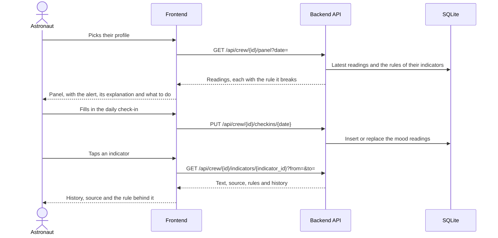

# Real Telemetry · MVP architecture

Scope: the MVP only (R1 to R11 in the System_design, system_design.md). Why each indicator and dataset was chosen is in the data document (parameters_and_datasets.md). The last section lists the starting decisions and how to change each one.

## 1. What we represent

Six concepts. Five are stored. One is computed.

| Concept | What it is | Example | Stored as |
| :-- | :-- | :-- | :-- |
| Crew member | A fictional astronaut. Their data comes from one LifeSnaps volunteer and one Inspiration4 astronaut | "Crew 1" | `crew_member` |
| Source | The dataset an indicator's data comes from (R11) | Inspiration4 metabolic panel | `source` |
| Indicator | One thing we measure, with its unit, how to take it and why it matters (R4 and the brief) | Blood glucose, mg/dL | `indicator` |
| Reading | One value of one indicator for one crew member at one moment | Crew 2, glucose, 36 mg/dL | `reading` |
| Rule | A limit on an indicator, with its explanation, what to do and where the limit comes from (R10, R11) | Glucose below 65 or above 99 | `rule` |
| Alert | A reading that is outside a rule's limits | Crew 2, glucose rule, that reading | Not stored. Computed when read |

What is not a concept:

- The daily check-in (R2, R3). It is the act that creates that day's mood readings.
- The CPR flow (R9). It is fixed content in the frontend. It has no table and no endpoint.
- Accounts and permissions. Not decided. The MVP has a profile picker with no password. If accounts are added later they travel in a header, so the contracts do not change.
- Alert levels. Not decided. A reading either breaks a rule or it does not.

## 2. Data model

One SQLite file with five tables.

```sql
PRAGMA foreign_keys = ON;  -- on every connection. SQLite ignores foreign keys without it

CREATE TABLE crew_member (
  id   INTEGER PRIMARY KEY,
  name TEXT NOT NULL UNIQUE
);

CREATE TABLE source (
  id       TEXT PRIMARY KEY,   -- readable key, e.g. 'lifesnaps'
  name     TEXT NOT NULL,
  url      TEXT NOT NULL,
  citation TEXT NOT NULL
);

CREATE TABLE indicator (
  id          TEXT PRIMARY KEY,   -- readable key, e.g. 'glucose'
  name        TEXT NOT NULL,
  unit        TEXT,               -- NULL for the mood indicators
  how_to_measure TEXT NOT NULL,   -- the brief asks for it per measurement
  why_it_matters TEXT NOT NULL,   -- the short explanation for R4
  source_id   TEXT NOT NULL REFERENCES source(id)
);

CREATE TABLE reading (
  crew_member_id INTEGER NOT NULL REFERENCES crew_member(id),
  indicator_id   TEXT    NOT NULL REFERENCES indicator(id),
  taken_at       TEXT    NOT NULL,   -- 'YYYY-MM-DDTHH:MM'
  value          REAL    NOT NULL,
  PRIMARY KEY (crew_member_id, indicator_id, taken_at)
);

CREATE TABLE rule (
  id               INTEGER PRIMARY KEY,
  indicator_id     TEXT NOT NULL REFERENCES indicator(id),
  low              REAL,
  high             REAL,
  title            TEXT NOT NULL,
  explanation      TEXT NOT NULL,
  action           TEXT NOT NULL,
  threshold_source TEXT NOT NULL,
  CHECK (low IS NOT NULL OR high IS NOT NULL)
);
```

Choices and why:

- One narrow `reading` table, not one column per indicator. A new indicator is new rows in `indicator`, `reading` and, if it has a limit, `rule`. No schema change (R8).
- One numeric value per reading. Mood is six yes or no indicators, stored as 1 or 0, because a LifeSnaps day can hold several moods. In the daily file 981 days have one mood, 973 have two, 335 have three and 1 has four.
- No `alert` table. A reading is an alert when `value < rule.low OR value > rule.high` for a rule of its indicator. Storing that again would duplicate what `reading` and `rule` already say.
- A rule may set only one side. Use two rules when the low side and the high side need different text.
- Limits live only in `rule`. The frontend never hardcodes one.
- Dataset subject ids (the LifeSnaps id, the Inspiration4 crew code) stay in the seed script. The app does not need them.

`taken_at`:

- One format for all readings. No time zone. LifeSnaps values keep the date and hour the file gives.
- Daily values and blood draws use `T00:00`. Hourly values use the hour.
- The Inspiration4 file has labels (L-92, R+45), not dates. NASA's study metadata gives them as "Launch minus" and "Return plus" in days. With launch on 16 September 2021 and landing on 18 September 2021 (UTC), the draws fall on 2021-06-16, 2021-08-03, 2021-09-13, 2021-09-19, 2021-11-02, 2021-12-09 and 2022-03-31. They can be off by one day, because the launch was on 15 September in local time.

How each dataset becomes readings:

| File | Indicator ids | Note |
| :-- | :-- | :-- |
| LifeSnaps daily | `resting_heart_rate`, `sleep_duration`, `sleep_efficiency`, `skin_temperature`, `very_active_minutes`, `steps`, `mood_happy`, `mood_sad`, `mood_tense`, `mood_alert`, `mood_rested`, `mood_neutral` | One reading per person, day and indicator. Each mood column holds 0 or 1 and becomes its own indicator. The frontend shows the six as one card |
| LifeSnaps hourly | `heart_rate` | One reading per person and hour |
| Inspiration4 metabolic panel | `glucose` | 7 readings per crew member |

An empty cell produces no reading.

## 3. Components

| Component | What it does | Reads | Writes |
| :-- | :-- | :-- | :-- |
| Seed script | Runs once before the demo. Creates the tables, turns the raw CSV files into readings and loads the crew, sources, indicators and rules | Raw CSV files | SQLite file |
| SQLite file | The only place data is stored |  |  |
| Backend API | Serves the crew, the panel and the history, with alerts computed. Saves the check-in | SQLite file | SQLite file |
| Frontend | Tablet web app. Profile picker, panel, indicator detail, check-in, CPR flow | Backend API |  |

Everything runs on board with no network calls at runtime. The frontend loads nothing from the internet.

Stack: Python with FastAPI for the backend and seed script, React with Vite and TypeScript for the frontend. Confirmed on 14 Nov, the base is built with it. Where each part lives is in the README.

The seed script is two files in `services/api`. `seed.py` holds the crew and the code that turns each CSV file into readings. `seed_content.py` holds the sources, the indicators and the rules, with their text.

Endpoints:

| Endpoint | Returns |
| :-- | :-- |
| `GET /api/crew` | The crew members, for the profile picker |
| `GET /api/crew/{id}/panel?date=` | For each indicator, its latest reading up to the end of `date`, with its `taken_at`, and the rule it breaks, if any, with that rule's text (R1, R10) |
| `GET /api/crew/{id}/indicators/{indicator_id}?from=&to=` | The indicator's text, source and rules, plus its readings between the two dates, each with the rule it breaks, if any (R4, R7, R10, R11) |
| `PUT /api/crew/{id}/checkins/{date}` | Body: moods, the list of mood indicator ids chosen. Saves the six mood readings for the date in the path, 1 for the chosen ones and 0 for the rest. Replaces them if they exist and returns what was saved (R2, R3) |

The dataset days are in 2021 and 2022, so "today" is the `date` the frontend sends, not the clock. The frontend prompts for the check-in when the panel's mood readings are not from `date` (R3).

### Contracts for the base

The exact JSON of the three endpoints the base needs. Frontend and backend build against it. A change here is agreed by both sides first.

- Dates are YYYY-MM-DD. taken_at is YYYY-MM-DDTHH:MM.
- The panel returns one entry per indicator. A missing reading or rule is null, never an absent key.
- Readings come ordered by taken_at, oldest first.
- An unknown crew member or indicator returns 404 with {"detail": "..."}.
- `date`, `from` and `to` are required. A missing or malformed one returns 422.
- `from` and `to` are both inclusive. The history runs from the start of `from` to the end of `to`.
- The panel lists the indicators in the order `seed_content.py` defines them.
- A reading exactly on a limit does not break the rule.

**`GET /api/crew`**

```json
{
  "crew": [
    { "id": 1, "name": "Crew 1" }
  ]
}
```

**`GET /api/crew/1/panel?date=2021-11-02`**

```json
{
  "date": "2021-11-02",
  "indicators": [
    {
      "id": "glucose",
      "name": "Blood glucose",
      "unit": "mg/dL",
      "reading": { "taken_at": "2021-11-02T00:00", "value": 36.0 },
      "broken_rule": { "id": 1, "title": "...", "explanation": "...", "action": "..." }
    },
    {
      "id": "heart_rate",
      "name": "Heart rate",
      "unit": "bpm",
      "reading": null,
      "broken_rule": null
    }
  ]
}
```

**`GET /api/crew/1/indicators/glucose?from=2021-06-01&to=2021-12-31`**

```json
{
  "indicator": {
    "id": "glucose",
    "name": "Blood glucose",
    "unit": "mg/dL",
    "how_to_measure": "...",
    "why_it_matters": "...",
    "source": { "id": "...", "name": "...", "url": "...", "citation": "..." }
  },
  "rules": [
    { "id": 1, "low": 65.0, "high": 99.0, "title": "...", "explanation": "...", "action": "...", "threshold_source": "..." }
  ],
  "readings": [
    { "taken_at": "2021-09-13T00:00", "value": 90.0, "broken_rule_id": null },
    { "taken_at": "2021-11-02T00:00", "value": 36.0, "broken_rule_id": 1 }
  ]
}
```

The numbers are examples. Text shown as "..." comes from the seed script. PUT /api/crew/{id}/checkins/{date} is not part of the base. Its body is { "moods": ["mood_happy", "mood_rested"] } and it returns what was saved.

## 4. Flow

One day on the tablet.



## 5. Alert rules

Three ways to decide an alert. We build them in this order.

1. Fixed range. The reading is outside a fixed low and high limit. It is in the base.
2. Personal baseline. The reading is compared with that person's own usual values. It comes after the base and adds columns to the rule table.
3. Anomaly models. A model learns each indicator and flags what is unusual. It is the stretch goal Indicator models in the System_design, built only if step 2 is not enough.

| Indicator | Alert in the data document | Limits | Where they come from |
| :-- | :-- | :-- | :-- |
| `glucose` | Abnormal glucose regulation. Glucose outside the personal target | 65 to 99 mg/dL | The range columns in the Inspiration4 file |
| `resting_heart_rate` | Tachycardia. Resting HR stays above the personal baseline | Above 100 bpm | American Heart Association definition of tachycardia. General adult reference, not a spaceflight limit |
| `sleep_duration` | Sleep deprivation. Duration below the personal target | Below 420 minutes (7 hours) | AASM and SRS consensus for adults, 2015 (doi 10.5664/jcsm.4758). General adult reference, not a spaceflight limit |
| `skin_temperature` | Possible infection. Raised temperature plus symptoms | No rule yet | Needs a source |
| Exercise | Insufficient exercise | No rule yet | Needs a source |
| The six mood indicators | Behavioural changes. Deviations in self-report | No rule yet | Needs a definition |

The MVP starts with these three rules. The sleep and heart rate limits are general adult references on Earth, used as a starting point, not spaceflight limits. The other three indicators are shown with no rule until someone brings a limit and a source. The mood rule is the first one to define. Why: mood is our only MVP indicator for mental health, which NASA rates red for Mars (System_design, section 1).

## 6. Build order

1. Schema and seed script with one crew member, `glucose` with its rule, and `heart_rate`.
2. Backend with the crew, panel and indicator endpoints.
3. Frontend with the profile picker, the panel and the indicator detail.
4. Check-in that saves the mood readings.
5. CPR flow in the frontend.
6. The other MVP indicators and the other three crew members.
7. The other rules, as they get a definition and a source.

Steps 1 to 3 are the base, and it is built. It shows NASA data, a history and an alert. The data model (section 2) and the contracts (section 3) are now fixed and the rest is built in parallel by two teams. Who builds what is in the [plan](plan.md), and how the branches work is in [branches.md](branches.md).

## Starting decisions

- Rules. Three fixed-range rules to start with: glucose, sleep and resting heart rate (section 5). To change one, edit its entry in `seed_content.py`. Personal baselines wait for step 2.
- Exercise. No rule for now. The panel shows `very_active_minutes` and `steps`. To add one, add an entry to the rules in `seed_content.py`.
- Temperature. No rule for now, because no dataset has symptoms. The panel shows `skin_temperature`.
- Dates. Readings keep the real dataset dates. The seed script has one number per crew member, an offset in days (0 by default), that shifts their LifeSnaps data. Crew 1 needs no shift. It is LifeSnaps volunteer 621e2f9167b776a240011ccb paired with Inspiration4 astronaut C003, whose glucose is 36 mg/dL on 2021-11-02. The demo date is 2021-11-02. To line up the other three crew members, change their offset.
- Gamification. Streaks only, computed from the mood readings. Anything else waits for the design owner.
