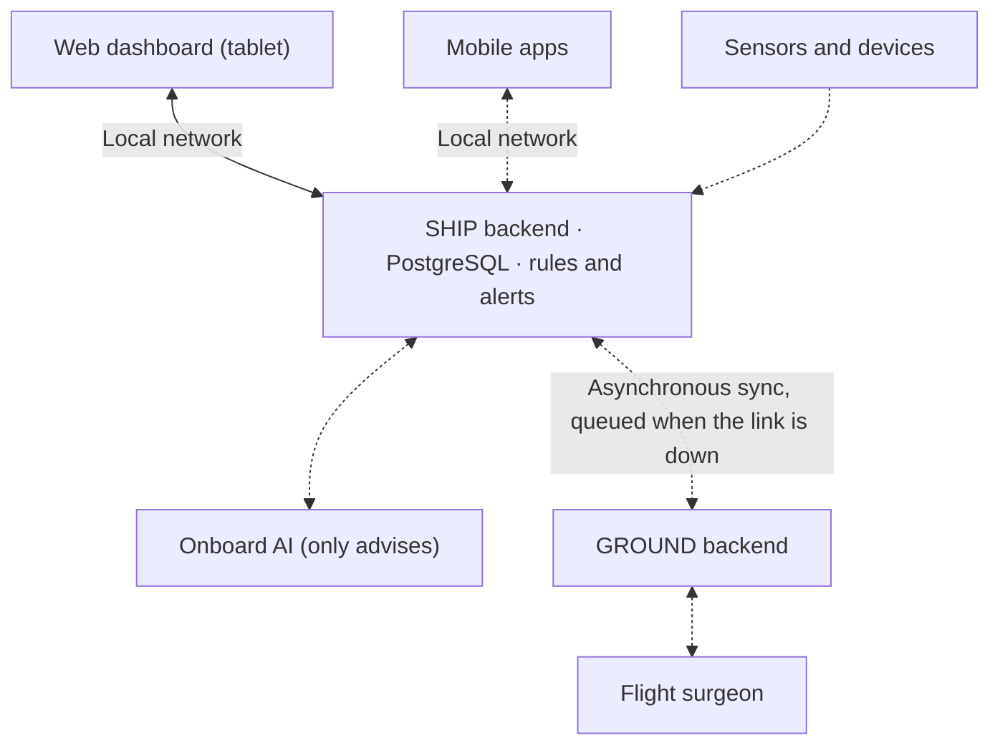

# Real Telemetry · System Design

## 0. About this document

**What is this:** A system design document describes *what* we are building, *for whom*, and *how* it will work, before we write code

**Why it's here:** In a hackathon, people with different backgrounds (medicine, design, engineering) work in parallel under time pressure. Without one shared reference, each person builds a slightly different product.

**How to read it:**  Each topic lives in one section only; if you want to add something, find where it belongs instead of repeating it

---

## 1. Challenge, problem and users

**Why it's here:** A well-defined problem is what makes a solution convincing, and it is the test for every feature: if a feature doesn't help with this problem, it doesn't belong in the MVP. Keeping the given facts and limits here makes it clear what we don't control, and every later section has to fit them.

### Challenge

NASA Space Apps Challenge 2026: "Create health monitoring software for astronauts on space missions", written by the Brazilian Space Agency (AEB). It asks for a visual tool that gathers health indicators so astronauts can assess their own health during a mission, act on the result, and get guidance on treatments, health improvements and emergencies. The video adds that solutions could also inspire health tools on Earth for remote communities with limited access to healthcare.

Our framing: the daily panel is designed for long missions in general, and Artemis IV is used only as the scenario for EVAs (stretch goals). Why: the brief talks about long missions, and the long-term indicators the panel tracks only matter on long missions.

### Problem

- Missions are getting longer and more independent from Earth: Artemis has already flown a crew around the Moon, and Mars is next. The concern is missions of a year or two, not a week or a month.
- NASA's Human Research Program lists five hazards of spaceflight: space radiation, isolation and confinement, distance from Earth, gravity fields and hostile closed environments.
- These hazards can lead to immune changes, bone density loss, cardiovascular events, poor nutrition and behavioral health problems. Effects on bone, muscle, eyesight and the heart are severe: after six months on the ISS, rehabilitation takes 45 days and bone can need two years to recover. Mental health is also a major issue on long missions.
- Risks come both from being in space and from being human: the first medical evacuation from the ISS, in January 2026, was for something NASA said was unrelated to spaceflight.
- On long missions, astronauts are largely responsible for spotting these changes in themselves. On the ISS, medical care works because of three things: real-time contact with an on-call flight surgeon, evacuation to Earth in under 24 hours, and regular resupply. On the Moon, evacuation takes 3 to 11 days, resupply is limited and communication drops; from Mars, a message takes up to 20 minutes each way.
- Today almost the whole chain (monitor, diagnose, decide, treat) happens on Earth. The useful question is which of those steps must work on board when Earth can't help.
- NASA calls the answer Earth Independent Medical Operations (EIMO): medical care moves from Earth to the crew as missions get farther away (Levin 2023). It is still open. HRP gap Medical-701 asks for tools that let astronauts give medical care on their own.

### NASA's pain points, in priority order

NASA's Human System Risk Board rates 30 health risks as green, yellow or red for each type of mission (Antonsen 2023, Table 4). These are the red ones a health tool can act on. The order is ours: the closer to today the mission where a risk turns red, the higher it goes. Why: it decides what we build, show and say first.

| # | Pain point | NASA risk | Red from |
| :-- | :-- | :-- | :-- |
| 1 | The crew has to solve problems alone, with less help from the ground | Human System Integration Architecture | Short stays on the lunar surface |
| 2 | Medical care has to work without Earth (EIMO) | Medical Conditions | Lunar missions over 30 days |
| 3 | Mental health and how the crew works together | Behavioral Medical, Team | Team from lunar orbit over 30 days. Behavioral Medical from Mars |
| 4 | Nutrition | Food and Nutrition | Mars |
| 5 | Long-term physical damage | SANS (eyes), Bone Fracture, Cardiovascular, Renal Stone | Long Mars missions |

The other red risks (EVA injury, dynamic loads, dust, crew egress, medication) depend on the vehicle and the suit, not on a health panel.

### Users and key scenarios

- **Astronauts:** assess their own health during the mission. They are not doctors: most are engineers or programmers with little biology or medical background, so the tool can't assume they know how to take a measurement or read a result.
- **Crewmates in an emergency:** need to know what to do when someone else is in danger.
- **Crew medical officer:** the crew member in charge of health. Not a doctor: about 60 hours of medical training, relying on a flight surgeon on Earth.
- **Commander:** responsible for the safety and health of the crew. Flight directors on Earth keep overall command, except in an emergency or when the link is lost.
- **Flight surgeons on the ground:** receive the results that need their attention.

Key scenarios:

- **Daily check-in:** each astronaut records their indicators and how they feel, as part of the routine.
- **Emergency:** the video's scenario: halfway to Mars, a crewmate feels a sharp pain in the chest and collapses. What is happening, and what should the others do?
- **EVA without connection (stretch goals only):** an astronaut outside feels unwell and communication with Earth is lost. Reference mission: Artemis IV, early 2028. Four crew fly in Orion and two land near the lunar South Pole for about a week. From there, Earth is visible only half of each month and low on the horizon, the suit links only to the lander, and there is no relay station. If communication is lost, NASA's procedure is to try to recover it and, if that fails, end the EVA and return.

### What the challenge expects

- For each measurement: how to take it, why it matters, and what to do when the value doesn't look normal.
- Guidance on what to do in an emergency.
- Simple explanations of measurements, indicators and risks.
- Metrics and diagnosis presented clearly; the brief says UI design plays an important role.

### Constraints and assumptions

- Data can come from any input (keyboard, mouse clicks, camera images) and be of any kind, as long as it represents a health indicator (for example, blood sugar in mg/dL or ultrasound images).
- Astronauts already spend about 2.5 hours a day exercising, so health checks must take little time.
- Health data follows the same rule in space as on Earth. A crewmate's medical data can't be used or shared without consent, except for the crew's immediate safety (ISS crew code of conduct).
- Artemis computing will rely only on on-board compute, with no cloud, so the whole system has to run on board.
- Crew devices are commercial. Each astronaut had a Windows tablet on Artemis II, and the ISS uses Windows and Linux laptops.
- The 2025 submission guide requires NASA data for a global award, bans personal data and asks teams to declare AI use and external resources. To confirm on 13 November.

### Submission guide (TODO: read carefully on Saturday)

<https://www.spaceappschallenge.org/resources/project-submission-guide/>

## 2. Scope and requirements

**Why it's here:** Time is the hardest constraint in a hackathon. Deciding the scope in advance protects the MVP from good ideas that arrive too late. Writing the MVP as requirements, instead of a feature list plus a separate requirement list, means each thing is written once and we can check at the end what works.

### MVP

A daily health panel used inside the spacecraft. Why: it is what the brief asks for, and it has to work really well before we add anything else.

- **R1.** Shows the MVP selected indicators (see data document), physical and psychological, in one view. Covers the brief's "metrics presented clearly".
- **R2.** Lets each astronaut record how they feel each day, as an indicator of long-term psychological state.
- **R3.** A daily check-in routine that prompts the astronaut and is gamified and friendly. Why: it takes pressure off checking your health and makes it less demanding.
- **R4.** Usable by people with no medical background: each variable is simplified and briefly explained. Covers the brief's "simple explanations".
- **R5.** Measurements are as non-invasive as possible. Why: they happen every day, so something like a daily skin prick isn't acceptable.
- **R6.** Takes as little time as possible and reduces stress instead of adding it.
- **R7.** Keeps the history of each indicator to track it over the long term. Why: the biggest concern is how health changes over months.
- **R8.** New indicators can be added over time. Why: the base can grow with each update.
- **R9.** Guided CPR flow with fixed steps on screen when a crewmate collapses. Covers the brief's "guidance on what to do in an emergency". It follows the ISS procedure (AED Assisted CPR) with one image per step. The defibrillator already talks, so we guide the steps around it and keep the timers. With a link the flow calls Earth. Without one it keeps going and the commander decides.
- **R10.** Each indicator warns when a value is out of range, explains it and says what to do.
- **R11.** Each indicator shows its source and the rule behind it, so anyone can check the science.

### How the scope answers NASA's pain points

Pain points are numbered as in section 1. Why: it shows what each requirement is for and which gap to close first.

| # | Pain point | Covered by | Gap |
| :-- | :-- | :-- | :-- |
| 1 | Crew solves problems alone | R4, R10, R11 | None in the MVP |
| 2 | Medical care without Earth (EIMO) | R7, R9, R10. Stretch: emergency assistant (E1 to E6) | Only one guided procedure (CPR). The link to the ground is decided (section 6) and not built yet |
| 3 | Mental health and team | R2, R3, and sleep in R1 | Mood has no rule, so it never warns (MVP architecture, section 5). Nothing covers the team risk (Not decided yet, below) |
| 4 | Nutrition | Glucose in R1 | Diet, hydration and body mass have no data (data document, Table 3) |
| 5 | Long-term physical damage | Exercise and heart rate in R1, R7 | Eyes, bone and ECG have no data (data document, Table 3) |

### Stretch goals (nice to have after MVP)

In this order:

1. **Emergency assistant:** an AI that guides the crew step by step, by voice, through emergency procedures. It starts from the CPR flow in the MVP and adds other cases, such as severe stress or low glucose. It is the next step once the platform works, because the panel must work first. Covers the brief's "guidance on what to do in an emergency".
    - **E1.** Runs on board, without Earth or the cloud.
    - **E2.** Guides each procedure step by step by voice, and explains each alert in short sentences.
    - **E3.** Only advises
    - **E4.** Every alert can be traced to the rule or model that triggered it.
    - **E5.** Detects when the link with Earth is lost and keeps working.
    - **E6.** Logs the emergency with timestamps and sends it to Earth when the link is back.
2. **EVA mini panel:** a simulated panel for the astronaut's suit during an EVA, which guides the return by comparing the time and oxygen left with the distance to the lander. It also shows decompression sickness risk, which NASA's Crew State and Risk Model already estimates from suit data.
3. **Other environments:** adapt the tool to a space station, a rover or a base on the Moon or another planet; the displays may change with each environment. JAXA and NASA agreed in 2024 that Japan will build a pressurized rover for Artemis. Why: we start with the spacecraft because it is the most useful.
4. **Cross-indicator warnings.** Warn about problems that only show when several indicators are read together, with a risk level
5. **Indicator models.** Models that learn each indicator and detect when something is going badly. They come after personal baseline rules (MVP architecture, section 5)
6. **Two profile types: commander and crew member.** The commander is responsible for the crew's health (section 1), so their profile shows the crew, not only themselves. What they see is not decided yet (below, and section 6)

### Not decided yet

| Item | Proposed / Open | Owner |
| :-- | :-- | :-- |
| What the commander profile sees (stretch goal 6). Two options: only who has an alert and who has checked in, with no values, which keeps the privacy decision in section 6. Or each crew member's full panel, which changes it | Open |  |
| Commander weekly report on the crew, plus an alert when someone shows a worrying trend, like a Duolingo classroom (Alex) | Proposed. Suggested out, it conflicts with the privacy decision in section 6 |  |
| Team risk (pain point 3): how the crew works together. Nothing in the scope covers it, and the commander report above is the only proposal that touches it | Open |  |

---

## 3. Data

**Why it's here:** In a health monitoring system, the data *is* the product. If a variable can't be measured, every feature built on it falls apart. The alert rules need to be explicit: a missed alert is dangerous, and too many false alarms make people ignore the system.

### What we measure

- **Mood:** self-reported in the daily check-in (R2).
- Indicators, how they are measured in space and the datasets are in the [data document](parameters_and_datasets.md), in this folder.

---

## 4. UI/UX

**Why it's here:** Our users are not medical experts and have little time and attention to spare. If the interface adds effort or stress, they won't use it, and the data never gets collected. It is also where our solution is most visibly different from others.

### Devices

- Designed for one tablet/phone per astronaut, built as a web app. Why: it matches real hardware (each Artemis II astronaut had one), which also strengthens the pitch.

### Screens

- Each indicator has a chart of its history. Why: R7 keeps the history and the brief suggests it.
- Color coding shows at a glance whether an indicator has an alert. Why: R10 asks each indicator to warn.
- The mood input offers the six moods in our data and allows more than one. Why: it matches the dataset.

### Gamification and tone

- Friendly and calm, with Finch as the reference rather than Duolingo. Why: Duolingo feels passive-aggressive, and nobody wants a passive-aggressive mascot during an EVA.
- Reference apps are compared in [Best gamified and fitness tracking apps (by ChatGPT)](https://docs.google.com/document/d/157zlTVx3JbUVLwCyYiybXNFL8ypWo_76oST3PJ0Hnd4/edit).
- The aesthetic and the gamification concept must be clearly defined by presentation day. Why: thousands of teams will take this challenge, and how it looks and how you interact with it is how we stand out.  Adolfo: I suggest starting with something easy, MVP-like that lets us see the main picture, and then start adding the things that will make the UX better
- Streaks for completing the daily check-in. Why: it is the cheapest gamification, built from readings we already store, and it covers the gamified part of R3.

### Not decided yet

| Item | Proposed / Open | Owner |
| :-- | :-- | :-- |
| A personified assistant, so it isn't only numbers; a companion also helps mental health (Rebecca) | Proposed |  |
| A pet that gains energy as you complete tasks, goes on adventures (Paris, Proxima Centauri) and unlocks outfits; you name it and choose its type (alien, astronaut…) (Àngels) | Proposed |  |
| Each astronaut has an avatar in their own little world, for life beyond the mission (Rebecca) | Proposed |  |
| A city or farm builder (Minecraft, Stardew Valley) where each plot is a medical check, daily or weekly (Alex) | Proposed |  |
| An Earth-themed world, exploring cities like Paris or Tokyo, where regions map to types of check (Europe mental health, Asia physical…). Pitch line: "Just don't forget where you come from" (Rebecca, Àngels, Alex) | Proposed |  |
| Clickable human figure: each body part shows its function and health status (suggested by the brief) | Proposed |  |
| Name for the app and the pet | Open |  |

---

## 5. Architecture

**What is this:** How all the parts connect, shown with a diagram plus a short description of each part: what it does, what it receives and what it sends

**Why it's here:** It is the map of the system. It lets the team split the work into pieces that can be built in parallel, and agreeing on the internal interfaces early means those pieces fit together at the end.

### Target architecture

The ship works on its own and the ground follows behind. Why: it is pain point 2 (EIMO) as a diagram. Solid lines are built. Dashed lines are planned.

| Part | What it does | Status |
| :-- | :-- | :-- |
| Web dashboard | The tablet app each astronaut uses | Built (MVP) |
| SHIP backend | Stores the readings in a PostgreSQL database, applies the rules and returns the alerts. Everything the crew needs runs here | Built (MVP) |
| Mobile apps | The same panel on a phone | Planned |
| Sensors and devices | Send readings on their own (Bio-Monitor shirt, wrist tracker, glucose monitor). Today the readings come from the datasets and the check-in | Planned |
| Onboard AI | Guides emergencies by voice and explains alerts. It only advises (E1 to E6) | Planned (stretch) |
| GROUND backend | Receives a copy of what the ship sends when the link is up. The ship never waits for it | Planned |
| Flight surgeon | Sees on the ground the full panel of each crew member (section 6) | Planned |

One database is enough for now. A second one on the ground comes with the GROUND backend.

How the built part works is in the [MVP architecture](mvp_architecture.md).

---

## 6. Privacy and failure

**Why it's here:** Health data is among the most sensitive personal data there is, and in space, failure is the normal case. Showing we designed for both from the start makes the solution credible and is often what separates a serious project from a demo

### Privacy and access

- Health data is private day to day. In an emergency, crewmates are alerted and see only the data needed to act, while it lasts.
- The flight surgeon on the ground sees the full panel of each crew member: indicators, history and alerts. Why: they are the crew's doctor, as on the ISS today. Privacy between crewmates on board does not change.
- Data goes one way, from the ship to the ground. The ground looks and does not answer. With the link down, the ship keeps working and what is new waits in a queue until the link is back.

### Not decided yet

| Item | Proposed / Open | Owner |
| :-- | :-- | :-- |
| Sharing is up to each astronaut; data is shared only with their health professional, or with a formal agreement | Proposed |  |
| Only a doctor on board can see everyone's data | Proposed |  |
| The commander can see everyone's data | Proposed |  |
| Individual accounts with a password, like Netflix profiles | Proposed |  |

---

## 7. Build, demo and success criteria

**What is this:** How we get from this document to presentation day: the workstreams and who owns each one, milestones up to the submission, the demo scenarios (what is live and what is mocked), the requirements that must work for the project to count as a success, and the risks with their plan B.

**Why it's here:** It turns the design into work. It comes last because it depends on everything above: we can only plan what to build and show once we know what we are building.

The tasks, the two teams and the dates are in the [plan](plan.md).

### Inputs collected so far, from the meeting

- Build: with AI (Claude Code, Adolfo's account), a front end and back end are doable in about 2 days. Build the base platform first, then split into parallel workstreams: gamification, AI, emergency (Adolfo).
- Demo: a normal scenario, then an emergency simulation, such as a heart attack with CPR guidance (Adolfo, Alex).
- Demo. Run the flow live and bring a backup recording.
- Pitch. Say "Earth Independent Medical Operations (EIMO)": NASA's name for moving medical care from Earth to the crew as missions get farther away (Levin 2023). It is what our panel works towards, and NASA still lists it as open (HRP gap Medical-701).
- Pitch. We found no open human data for the most severe effects (bone, muscle, eyesight). The panel tracks exercise, the main countermeasure, and their alerts are ready for when data exists.
- Priority rule. Among the indicators we have data for, show first the ones behind the risks NASA rates highest for a long mission (Antonsen 2023, Table 4). Next steps follow the same rule, as a separate list. With the order in section 1 that gives: mood, glucose, heart rate, exercise, then sleep and temperature, whose risks (Sleep Loss, Immune) are yellow.
- Team: Àngels knows 3D animators for character or background design

### Pitch: NASA's pain points and our answer

In the pitch, name each pain point and answer it, in this order, two lines each: what goes wrong in deep space, then what Real Telemetry does about it. Why: the judges hear the problem and our solution together, in NASA's own terms. The order and the sources are in section 1.

1. **The crew is alone.**
    - Problem: on the ISS the ground follows every step. Farther out the crew has to handle problems alone, and NASA already rates this red for a short stay on the Moon.
    - Our answer: the panel is built for a crew with no doctor. Every indicator says how to measure it, why it matters and what to do, and shows its source.
2. **Medical care without Earth. Say "Earth Independent Medical Operations (EIMO)".**
    - Problem: today monitoring, diagnosis and decisions happen on Earth. From Mars a message takes up to 20 minutes each way and nobody can be evacuated. NASA calls the fix EIMO and still lists it as open.
    - Our answer: everything runs on board. The panel warns and says what to do, and the CPR flow guides the crew with or without a link.
3. **Mental health and team.**
    - Problem: months of isolation with the same few people. NASA rates behavioural health and team work red for Mars.
    - Our answer: a daily check-in of mood, next to sleep, kept over months so a slow change shows. How the team works together is what we don't cover yet.
4. **Nutrition.**
    - Problem: a Mars crew can't count on resupply, and NASA rates nutrition red for Mars.
    - Our answer: blood glucose from real astronauts (NASA, Inspiration4), with an alert from the data's own range. Logging diet and hydration on the tablet is next.
5. **Long-term damage.**
    - Problem: eyes, bone, heart and kidneys change over a long mission, and NASA rates them red for a long Mars mission.
    - Our answer: the panel tracks exercise, the main countermeasure, and heart rate, and keeps every history. The alerts for eyes and bone are defined and waiting for data.

## 8. On-site research for the MVP design

[image]

- NASA’s datasets (public and request-only portals):
    - NLSP (NASA’s Life Science Portal): [Explore - NLSP](https://nlsp.nasa.gov/explore?dataType=EXPERIMENTS&sortBy=dateAdded_desc&page=1&limit=25&view=table)

Publicly available documents regarding experiments ran in space. Complete datasets from the experiments: <https://nlsp.nasa.gov/explore?dataType=EXPERIMENTS&archive_status=*publicly+available*&sortBy=dateAdded_desc&page=1&limit=25&view=table>

    - LSAH (Lifetime Surveillance on Astronaut’s Health): [LSAH - NLSP](https://nlsp.nasa.gov/resources/lsah)

Experiments’ outline, can cross-reference with NLSP data to match experiment outline with data and results.

---

## Appendix: Glossary and references

**What is this:** Short definitions of technical and medical terms (EVA, HRV, SANS, MVP, API…), and links to the challenge brief, datasets, APIs and papers used in the document.

**Why it's here:** The team and the judges come from different fields, and claims about health and space need evidence anyone can check.

### References

- NASA Space Apps Challenge 2026, "Create health monitoring software for astronauts on space missions": challenge page (link pending) and video: <https://youtu.be/RERG3gEmdC8>
- Meeting notes, 1 Nov 2026: separate document
- NASA Space Apps participant FAQ, 2026, <https://www.spaceappschallenge.org/resources/participant-faqs/>
- Space Apps project submission guide, 2025, <https://www.spaceappschallenge.org/resources/project-submission-guide/>
- Space Apps judging guide, 2024, <https://spaceappschallenge.org/resources/judging-awards-guide>

Medical care on the ISS and far from Earth:

- Levin et al., 2023, ISS medical model and EIMO: <https://www.ncbi.nlm.nih.gov/pmc/articles/PMC10810302/>
- NASA OCHMO-TB-044, medical operations, 2025: <https://www.nasa.gov/wp-content/uploads/2025/08/ochmo-tb-044-medical-operations.pdf>
- Biomedical Results of Apollo, 1975: <https://ntrs.nasa.gov/api/citations/19760005581/downloads/19760005581.pdf>
- First medical evacuation from the ISS, January 2026 (NPR): <https://www.npr.org/2026/01/15/nx-s1-5677647/nasa-spacex-crew-11-splashdown-return>
- ISS crew code of conduct, 14 CFR 1214.403, <https://www.govinfo.gov/content/pkg/CFR-2023-title14-vol5/pdf/CFR-2023-title14-vol5-sec1214-403.pdf>
- Roden and Ewert, 2006, health evaluations on the ISS, <https://ntrs.nasa.gov/api/citations/20060051792/downloads/20060051792.pdf>
- Chauvin et al., rehabilitation after ISS flights, <https://ntrs.nasa.gov/citations/20100042641>
- NASA OCHMO-TB-030, bone loss, 2023, <https://nasa.gov/wp-content/uploads/2023/03/bone-loss-technical-brief-ochmo-1.pdf>
- Bone recovery after flight, ASME 2004, <https://ntrs.nasa.gov/api/citations/20050220685/downloads/20050220685.pdf>
- Gabel et al., 2022, bone loss in flight, <https://pmc.ncbi.nlm.nih.gov/articles/PMC8862023>
- Crucian et al., immune changes and virus reactivation, <https://ntrs.nasa.gov/api/citations/20100040666/downloads/20100040666.pdf>
- Bio-Monitor sensor shirt on the ISS (Hexoskin), <https://www.hexoskin.com/blogs/news/tagged/astronaut-health?page=1>
- ISS emergency medical procedures, NASA JSC, FOIA 16-JSC-F-00174, 2016, <https://www.governmentattic.org/19docs/NASA-ISSmedicalEmergManual_2016.pdf>
- NASA HRP, Sudden Cardiac Arrest and related gaps, 2014, <https://humanresearchroadmap.nasa.gov/Evidence/medicalConditions/Sudden_Cardiac_Arrest.pdf>
- CSA, Bio-Monitor, <https://www.asc-csa.gc.ca/eng/sciences/bio-monitor.asp>
- NASA, wearables on the ISS (Actiwatch), <https://www.nasa.gov/missions/station/iss-research/wearable-tech-for-space-station-research/>
- Suite Ride glucose monitoring on Ax-4, 2025 (Axiom Space), <https://axiomspace.com/release/suite-ride-research-unlocks-potential-for-first-astronaut-with-diabetes>
- ISS daily report with tonometry, 2015, <https://www.nasa.gov/blogs/stationreport/2015/08/04/iss-daily-summary-report-08-4-15/>
- Body mass in microgravity (Smithsonian), <https://www.smithsonianmag.com/daily-planet/how-do-astronauts-weigh-themselves-space-180953884/>
- NASA HRP, distance from Earth, <https://www.nasa.gov/hrp/hazard-distance-from-earth/>
- ESA, role of the ISS commander, <https://blogs.esa.int/luca-parmitano/?p=1670>

Risk by mission type:

- NASA Human Research Roadmap: <https://humanresearchroadmap.nasa.gov/explore/> (medical conditions risk: <https://humanresearchroadmap.nasa.gov/Risks/risk.aspx?i=95>)
- NASA HRP gap Medical-701, in-flight medical capabilities: <https://humanresearchroadmap.nasa.gov/Gaps/gap.aspx?i=716>
- Platts, 2024, risks by mission: <https://ntrs.nasa.gov/api/citations/20240013142/downloads/Platts%20Maine%202024%20final.pdf>
- Antonsen et al., 2023, NASA's risk method: <https://www.ncbi.nlm.nih.gov/pmc/articles/PMC10485075/>

Artemis IV and lunar communications:

- Artemis IV mission page: <https://www.nasa.gov/mission/artemis-iv/>
- Artemis program overhaul, February 2026 (Spaceflight Now): <https://spaceflightnow.com/2026/02/27/nasa-announces-major-overhaul-of-artemis-moon-program/>
- HLS Update, 2024: <https://ntrs.nasa.gov/api/citations/20240009596/downloads/ArtemisHLSUpdate_2024.pdf>
- Artemis overview for Space Apps, 2025: <https://ntrs.nasa.gov/api/citations/20250009323/downloads/ArtemisOverview2025IntSPAPPSChallenge.pdf>
- Lunar communications and navigation architecture, 2024: <https://www.nasa.gov/wp-content/uploads/2024/01/lunar-communications-and-navigation-architecture.pdf>
- xEVA System Concept of Operations, EVA-EXP-0042 Rev B, 2020 (sections 4.2.1.6 and 9.5): <https://www.nasa.gov/wp-content/uploads/2017/02/eva-exp-0042_xeva_system_con_ops_rev_b_final_dtd_10192020_ref_doc.pdf>
- NASA and JAXA pressurized rover agreement, 2024, <https://www.flyingmag.com/?p=200208>

On-board computing and assistants:

- ICES-2023-298, EVA on-board computing: <https://ttu-ir.tdl.org/bitstreams/aa55989e-a6f5-4dc4-8d13-8879ad3d560e/download>
- RASAGE, Li and Whittle, SpaceCHI 2025: <https://drops.dagstuhl.de/storage/01oasics/oasics-vol130-spacechi2025/OASIcs.SpaceCHI.2025.6/OASIcs.SpaceCHI.2025.6.pdf>
- Laptops used on the ISS (TechRepublic), <https://www.techrepublic.com/pictures/photos-from-the-thinkpad-to-the-ipad-the-tech-used-on-the-iss/>
- Artemis II crew devices, 2026 (Gizmodo), <https://gizmodo.com/i-regret-to-inform-you-that-the-artemis-ii-astronauts-are-having-lots-of-screen-time-2000742513>

EVA monitoring (stretch goals):

- ICES-2022-429, heart-rate-only decision for the lunar suit: <https://ttu-ir.tdl.org/server/api/core/bitstreams/f3decabb-9bca-44bb-b89f-160571c8971e/content>
- Gernhardt and Dervay, 2013, EVA monitoring today: <https://www.nasa.gov/wp-content/uploads/2023/03/gernhardt-eva-ops-chp-5.4-2013.pdf>
- EVA Console Handbook, JSC-20597, 2010: <https://ibiblio.org/apollo/Shuttle/MCC/EVA%20Console%20Handbook%20-%20EMU%20Operations.pdf>
- Crew State and Risk Model, ICES-2025-157: <https://ttu-ir.tdl.org/server/api/core/bitstreams/d8790c6b-22bd-4ee3-a6ea-e5bbf988ca0b/content>
- Miller et al., NASA/TP-2017-219457, digitized Apollo EVAs: <https://ntrs.nasa.gov/api/citations/20170007261/downloads/20170007261.pdf>
- NASA OCHMO-TB-020, radiation protection: <https://www.nasa.gov/wp-content/uploads/2023/03/radiation-protection-technical-brief-ochmo.pdf>
- Anderson et al., 2026, cognitive load in EVA: <https://pmc.ncbi.nlm.nih.gov/articles/PMC12883836/>
- NASA OCHMO, decompression sickness brief, <https://www.nasa.gov/sites/default/files/atoms/files/dcs_technical_brief_ochmo.pdf>
